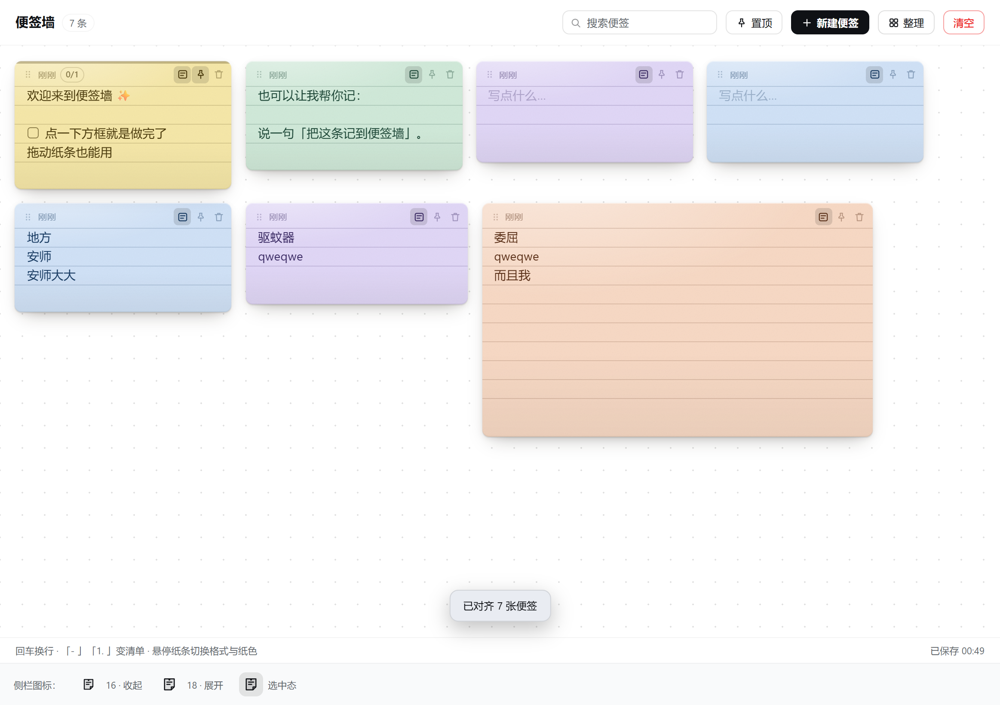
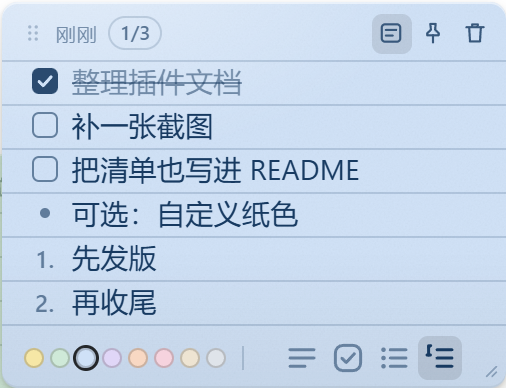

# 便签墙 · dsh-plugin-sticky-wall

DSH 侧栏里的一面便签墙：随手贴、随手拖、随手改，**并且模型能直接往上贴**。
不是待办清单——待办有 `todo_write`；便签墙放的是那些「先记一下」的碎片，
要清单也能就地长成清单。





## 功能

- **侧栏一个图标，主面板一面墙**：注册 `sidebar.panellist`（id = `sticky-wall`）+ `main` 同名 key，
  点图标切到主面板，和 QQ 机器人面板同一套机制。
- **一行一种格式**：正文 / ☐ 待办 / • 无序 / 1. 有序，四种混排。
  待办点方框即「已完成」（打勾 + 删除线），抬头显示 `1/3` 进度。
  行首敲「- 」「1. 」「- [ ] 」直接变成对应格式；悬停纸条底部还有四个格式按钮，
  作用在「当前这一行」上，点一下就能切换，再点「≡」回到普通正文。
- **横线纸可选**：抬头那个「带横线的纸」图标，点一下在横线纸 / 空白纸之间切换，逐张便签独立记。
  横线按 14px/22px 的行距画在每行下沿，字正好落在线上；纸高按整行增长，永远不会切半行。
- **纸的质感**：8 种纸色（亮纸 + 深墨）+ 细颗粒噪声 + 左上柔光 + 下沿压暗 +
  **8px 圆角**（纸面内容按圆角裁切）+ 内外两层阴影。**不做倾斜**——旋转层里的文字会丢次像素抗锯齿，
  看着发虚，所以纸是摆正的。
- **可调大小**：右下角的斜线手柄（悬停出现）拖一下就能改大小——宽 196–560px，
  高按 22px 的整行增减，双击手柄回默认；窄到 240px 以下时底部调色盘自动收起，把位置让给行格式按钮。
- **随手摆放**：按住纸头（含六点抓手的那条）拖到任意位置，落点按百分比存，
  面板宽窄变了也不会散架。双击空白处即在点击处新建一张。
- **就地编辑**：每行都是一个输入框，点进去直接改；输入 0.65s 后自动落盘，
  失焦 / `⌘/Ctrl+Enter` / `Esc` 都会立即保存。回车拆行、行首退格并回上一行、↑↓ 跨行移动。
- **纸色 / 置顶 / 删除**：悬停纸条出现调色圆点；置顶的纸永远在最上层（顶部一道墨色压边）。
- **搜索 / 只看置顶 / 整理 / 清空**：搜索按正文过滤；「整理」是流式重排（见下）；
  清空需要点两次。
- **整理 = 对齐，不是重排**：按你摆的位置把便签聚成行（y 差 56px 内算同一行），
  行内保持你的左右顺序、统一左对齐、间距 16px；行与行按「这一行最高 + 16px」往下排，
  左边距 18px。**不会因为某张纸大就把它排到后面去**——宽纸还待在它那一行里。
  一行真的比面板宽时，先把行内间距压到 8px，仍放不下才把这一行末尾的几张挪到下一行。
- **跨会话持久化**：`$DSH_HOME/sticky-wall.json`（默认 `~/.dsh/sticky-wall.json`），原子写。
- **和模型联动**：4 个工具，说一句「把这条记到便签墙」就会真的贴上；
  模型贴来的 Markdown（`- [ ]` / `- ` / `1. `）会自动解析成复选框和列表；
  模型贴的便签 6 秒内自动出现在墙面上（面板可见时轮询）。

## 交互一览

| 操作 | 效果 |
|---|---|
| 点侧栏「便签墙」图标 | 切到便签墙主面板 |
| 点「新建便签」 | 新建并聚焦第一行 |
| 双击墙面空白处 | 在该处新建一张 |
| 按住纸头拖动 | 移动便签（松手保存） |
| 回车 | 在当前行下方拆出一行（同格式） |
| 行首退格 | 列表/待办行先退回正文；空行则并到上一行 |
| 敲「- 」「1. 」「- [ ] 」 | 当前行变成无序 / 有序 / 待办 |
| 点待办方框 | 打勾（已完成，带删除线） |
| 悬停 → 底部 ≡ ☐ • 1. | 把当前行切成 正文 / 待办 / 无序 / 有序 |
| 悬停 → 右下角斜线手柄 | 拖动改大小（宽 196–560px、高按整行）；双击回默认 |
| 悬停 → 抬头方格图标 | 横线纸开 / 关 |
| 悬停 → 调色圆点 | 换纸色 |
| 悬停 → 📌 / 🗑 | 置顶 / 撕掉 |
| 「置顶」筛选 | 只看置顶便签 |
| 「整理」 / 「清空」 | 按网格重排 / 连点两次清空 |

## 模型工具

| 工具 | 用途 |
|---|---|
| `sticky_wall_list` | 读墙上的便签（id、纸色、时间、正文；清单会带 `- [ ]` / `1.` 标记），可按 `pinned`/`query` 过滤 |
| `sticky_wall_add` | 贴一张新便签（`text` 必填，支持 Markdown 清单，`color`、`pinned` 可选） |
| `sticky_wall_update` | 改正文 / 纸色 / 置顶（正文会重新解析成行，勾选状态会重置） |
| `sticky_wall_remove` | 撕掉一张（不可撤销） |

返回文本里带 `[n-xxxxxx]` 这样的短 id，后续 update/remove 用它。

## 数据与隐私

- 全部数据只存在本机 `~/.dsh/sticky-wall.json`，不上传、不联网。
- 一张便签 = `lines[]`（每行 `kind/text/done`）+ 纸色/位置/置顶/横线开关 + 尺寸（`w`、`minLines`）；
  `text` 是从行派生的可读副本，给搜索和工具用——所以老数据（只有 `text`）能直接读，
  下次保存时自动升级成行结构。
- 上限：500 张便签、每张 200 行 / 每行 1000 字 / 合计 4000 字；超出直接拒绝而不是悄悄截断。
- 首次加载会在文件缺失时放两张欢迎便签，之后不再写入任何默认内容。

## 结构与实现要点

```
dsh-plugin-sticky-wall/
├── package.json        # dsh.bundle.patch + dsh.client.platform=web + exports["./client"]
├── cordis.patch.yml    # 插入一行：id=sticky-wall, name=dsh-plugin-sticky-wall
├── index.js            # Host 半侧：行模型 / 存储 / HTTP 端点 / 4 个模型工具（零第三方依赖）
├── client.js           # Client 半侧：ModuleLoader bundle，两处 slot 注册 + 整面墙的 UI
└── docs/               # 截图
```

- 双面插件：Host 起 `webServer` 前缀路由 `/api/dsh-sticky-wall/*`，Client 同源 `fetch` 读写，
  不碰 typert/remote，也就没有版本适配问题。
- `client.js` 是**手写的 ModuleLoader bundle**（`window.__ModuleLoader__.load({ id, factory })`），
  只 `require('react')`——平台种子表提供，不需要构建步骤，改完刷新页面即生效。
- **行模型**：`lines: [{ id, kind, text, done }]`，`kind ∈ text|todo|ul|ol`。
  有序列表按「连续 ol 段」在前端重新编号，所以增删行不用重写编号；
  `textFromLines()` / `linesFromText()` 在两端各有一份同构实现，保证工具写入与老数据解析一致。
- **横线是 background 画的**，不是额外元素：
  `.sw-body` 用 `linear-gradient` 画 1px、`background-size: 100% 22px`，
  `background-position-y = 行距 + 上内边距`，所以第一条横线正好是第一行的下沿；
  每个行盒高度都吸附到 22px 的整数倍，横线不会被切半。改行距只需同步
  `LINE_H`（JS）与 `--sw-lh`（CSS），`NOTE_W` 决定网格列数。
- **写入的并发安全**：每次本地改动会给该便签打一个自增 revision；保存回包返回时
  只有 revision 没变才清 dirty，否则保留本地版本（避免「勾选的同时旧保存回包把状态盖回去」）。
- **尺寸**：`w`（px，196–560）与 `minLines`（1–30，按 22px 行高换算）。
  拖手柄时只改元素的内联宽高与 `--sw-min-lines`（实时预览），松手才写回 store；
  高度用 `min-height` 表达，所以便签永远「至少这么高、内容多了自己长」。
- **窄便签自适应**：`.sw-note` 开了 `container-type: inline-size`，
  容器查询在 ≤240px 时收起调色盘；纸用 `overflow: hidden` + 8px 圆角，横线会被圆角自然裁掉。
- **整理的量尺**：直接读 DOM（`offsetWidth/offsetHeight`）拿每张纸的真实尺寸，
  被搜索过滤掉、量不到的才用 `行数 × 22 + 头尾` 估算；先按现有 y 聚行、行内按 x 排序，
  再统一落位。整定是**幂等**的：连点两次结果一样（第一次排完就已经是对齐状态）。
  排完若内容高于画布，把画布 `min-height` 撑到 `内容高 / 0.84`，
  既让点阵随之延长，也保证最后一行换算成百分比后不超过宿主侧 88% 的 y 上限。
- **图标**：全部是 24 网格的 path，**不用文字字形**（`≡ ☐ • 1.` 那种会受字体影响、基线与重量都不齐）。
  描边按尺寸取：≤20px 用 2（12px 时正好 1px 实心线），更大的用 1.6；圆头圆角。
  行格式四个按钮是 18px 图标配 22px 按钮，抬头三个小图标 13px 配 20px 按钮；
  小尺寸的图形都做了减法（垃圾桶去掉内部竖线、横线纸只画两条线、抓手点放大到 1.5），
  免得 12–13px 时糊成一团。
- 纸面质感全在 CSS：SVG `feTurbulence` 噪声（data URI）+ 柔光 + 下沿压暗 + 内外阴影，
  文字不做变形，保证 1x 屏上也是清楚的。
- 颜色一律走 DSH 主题令牌（`--dsw-alias-*`），纸色是固定的亮纸深墨，
  所以浅色/深色主题下都像「桌上的纸」而不是「界面里的卡片」；横线与复选框描边是
  `color-mix(in srgb, currentColor 16~58%, transparent)`，跟着纸的墨色走。
- 样式通过 `data-plugin` + `data-plugin-css` 标记注入；热替换时若旧标签还在，
  `installStyles()` 会比较内容并原地改写，避免新样式被幂等判断挡掉。

## 安装 / 卸载

```bash
# 装（profile 里以 file: 依赖链接本目录）
dsh plugin add D:/workspace/dsh/dsh-plugin-sticky-wall
# 或直接让 agent 调 plugin_manager install_bundle

# 卸载
dsh plugin remove dsh-plugin-sticky-wall
```

## 已知限制

- 便签是自由摆放的：窗口变得很窄时可能出现重叠，用「整理」重排即可。
- 高度只有「最少几行」这一个维度：内容比它高时纸会自己长，所以拖高只会变高、不会把内容裁掉。
- 列表只有一层，不支持嵌套；每行一个格式，不混排（正文行里不能再嵌入列表）。
- 轮询间隔 6 秒，多窗口同开时另一边的改动最多滞后一个周期。
- 工具改正文会重建行，勾选状态会丢；要保留勾选请只在 UI 里改。
- 不做撤销（删了就删了），也不做富文本/附件——便签就该是纯文本。
- 没有服务端鉴权：沿用 DSH 自身的同源 + 本地回环边界。
